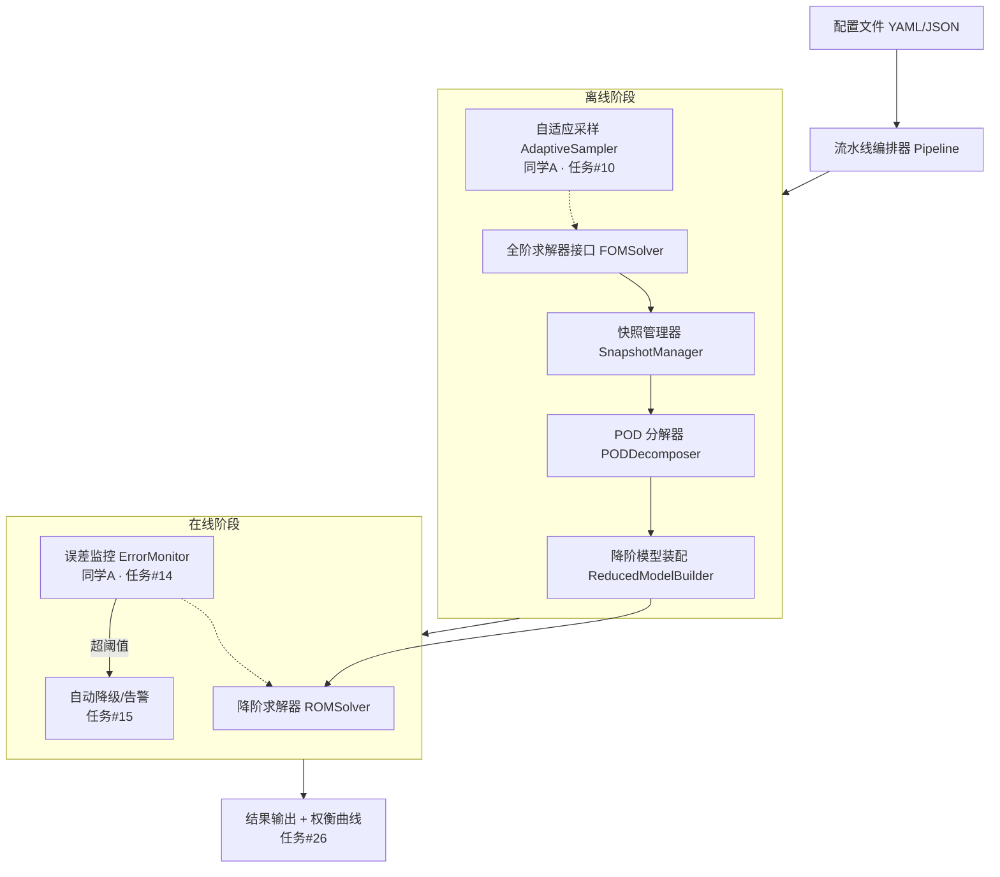

# 通用 POD-Galerkin ROM 框架 · 架构设计文档

> 任务 #8 ｜ 负责人：同学 B ｜ 版本 v0.1（2026-09-11）
> 依据：任务 #3/#4 最小 Demo 的实践经验 + 电池热管理技术方案
> 评审：需同学 A 确认数学接口（投影算子、残差定义）

---

## 1. 设计目标

| 目标 | 验收标准 |
|------|----------|
| **G1 解耦**：快照/POD/求解器三层独立 | 更换 PDE 算例不改核心框架代码 |
| **G2 可插拔**：误差监控、自适应采样作为可选模块 | 不挂监控模块时流水线照常运行 |
| **G3 端到端**：配置文件 → 结果输出一条流水线 | 任务 #22 的 v1.0 能直接复用本架构 |
| **G4 可开源**：接口清晰、有单元测试、有三套示例 | 任务 #23 的 GitHub 仓库标准 |

**非目标（明确边界）**：不做强非线性/激波/双曲系统；不发明新数学（数学创新在 A 的采样与误差估计算法，框架只提供挂载点）。

---

## 2. 分层架构



### 三层解耦的核心规则

1. **层间只传数据，不传实现**：快照矩阵 `S (n_x, n_t)`、基矩阵 `V (n_x, r)`、参数对象
2. **物理细节下沉到"算例插件"**：每个 PDE 算例实现 `FOMSolver` 协议即可接入，框架不认识"热传导"
3. **数学创新是插件，不是地基**：自适应采样和误差监控通过协议挂载，缺失时框架退化为传统固定快照 ROM（这也是任务 #24 对比实验所需的"对照组"模式）

---

## 3. 核心抽象与接口

### 3.1 `FOMSolver`（全阶求解器协议）

```python
class FOMSolver(Protocol):
    def solve(self, params: ParamSet) -> FOMResult:
        """给定参数，返回 (x, t, snapshots)。"""
    def operators(self, params: ParamSet) -> Operators:
        """返回连续/离散算子 (A, b)，供 Galerkin 投影用。"""
```

- 已有实现：[heat_1d.py](src/fom/heat_1d.py)（任务 #3）
- 待实现：`Heat2DBatterySolver`（任务 #11）、`Poisson2DSolver`（#12）、`ReactionDiffusionSolver`（#17）
- **决议**：`operators()` 暴露连续形式 `dT/dt = AT + b`；积分格式由 ROMSolver 决定（任务 #4 已验证该形式与隐式 FOM 一致）

### 3.2 `SnapshotManager`（快照管理器）

职责：快照的采集、存储、标注、增量更新。

```python
class SnapshotManager:
    def add_run(self, params: ParamSet, result: FOMResult) -> None: ...
    def basis_input(self) -> np.ndarray: ...      # 拼接全部快照 (n_x, Σn_t)
    def param_table(self) -> pd.DataFrame: ...    # 每组参数 ↔ 快照索引
    def save(self, path) / load(path): ...        # HDF5 或 npz + JSON 元数据
```

关键设计：
- **参数标注是头等公民**：每条快照必须可回溯到参数点，否则自适应采样（A 的模块）无法工作
- **支持增量追加**：自适应采样跑出新快照后直接 `add_run`，基可以重算
- 存储格式：`.npz`（快照 + 参数表 JSON），快照量大后迁移 HDF5

### 3.3 `PODDecomposer`（POD 分解器）

```python
class PODDecomposer:
    def fit(self, S: np.ndarray, center: bool = True) -> PODBasis: ...
    def energy_spectrum(self) -> np.ndarray: ...
    def rank_for_energy(self, threshold: float) -> int: ...
```

- 已有原型：[pod_galerkin_1d.py](src/rom/pod_galerkin_1d.py) 中的 `PODBasis`
- 归属说明：分解本身 B 实现；**rank 选取策略后续可接入 A 的自适应准则**
- 待定项：多参数快照的加权（长时间 vs 短时间 run 的快照数不均，是否按参数点等权）→ 与 A 讨论

### 3.4 `ReducedModelBuilder` + `ROMSolver`

```python
class ReducedModelBuilder:
    def build(self, basis: PODBasis, ops: Operators) -> ReducedModel:
        """A_r = VᵀAV, f_r = Vᵀ(AT̄+b)（线性情形）。"""

class ROMSolver(Protocol):
    def solve(self, model: ReducedModel, params: ParamSet,
              monitor: ErrorMonitor | None = None) -> ROMResult: ...
```

- 线性抛物/椭圆：投影即得小稠密矩阵，直接装配（任务 #4 已验证）
- 弱非线性（#16）：`ReducedModel` 需额外携带投影后的非线性项求值器，接口预留 `nonlinear: Callable | None`
- `monitor` 参数即任务 #14/#15 的挂载点：每步回调，返回告警标志

### 3.5 `ErrorMonitor` / `AdaptiveSampler`（A 的插件协议）

```python
class ErrorMonitor(Protocol):
    def check(self, a: np.ndarray, residual: np.ndarray) -> Alert: ...
    """残差阈值判定（A 出算法），B 负责在求解循环中埋点调用。"""

class AdaptiveSampler(Protocol):
    def suggest(self, snapshot_mgr: SnapshotManager,
                basis: PODBasis) -> list[ParamSet]:
        """根据现有快照与基，建议下一批全阶采样参数点。"""
```

> 📌 2026-10-20：认证误差界（#14）的挂载接口已冻结为
> `CertifiedBoundFn = fn(model, params, ctx) -> BoundResult`
> （`src/rom/estimators.py`），细则见 `docs/interface_certified_bound.md`。
> ErrorMonitor 逐步告警（#15）仍用上面的回调协议，两者互补：一个是
> 查询点级严格上界，一个是时间逐步的运行时告警。

---

## 4. 数据流与目录结构

```
isef-rom/
├── src/
│   ├── fom/            # 算例插件：heat_1d ✅ / battery_2d / poisson_2d / rd_2d
│   ├── rom/            # 核心框架：pod / builder / solver / monitor / sampler
│   ├── pipeline/       # 编排器 + 配置解析 + 输出模块
│   └── utils/          # 日志、参数集、IO
├── examples/           # 三套示例（任务 #23）
├── tests/              # 单元测试
├── logs/               # 失败案例数据库（failure_log_01.md ✅）
└── docs/               # 本文档、数学推导（A）
```

配置驱动示例（任务 #22 的雏形）：

```yaml
case: heat_1d
params: {k: 1.5, h: 1000, q_gen: 5.0e4}
offline: {energy_threshold: 0.999}
online:  {monitor: residual, dt: 1.0}
```

---

## 5. 里程碑挂钩

| 时间点 | 架构验证方式 |
|--------|--------------|
| 2027-03 末 | A 的采样器经 `AdaptiveSampler` 协议接入，在电池快照库上联调（ROM 误差 <5%） |
| 2027-07 末 | A 的误差监控经 `ErrorMonitor` 协议嵌入 500 组扫描（告警准确率 >80%） |
| 2027-10 末 | 配置驱动流水线 v1.0，三套示例跑通，冻结 |

## 6. 已识别的风险

1. **非线性项接口可能返工**（#16 是数值震荡重灾区）→ 第 5-8 月前只做线性装配，接口留 `nonlinear` 钩子不深入
2. **多参数快照拼接的基质量问题** → 与 A 讨论加权方案，必要时分参数簇建多基
3. **过早抽象**：当前只有 1D 一个算例，接口按"两个算例能跑"的最小通用性设计，2D 电池模型（#11）落地时再泛化一次

---

> 待同学 A review：§3.1 算子暴露形式、§3.4 投影装配约定、§3.5 两个插件协议签名
